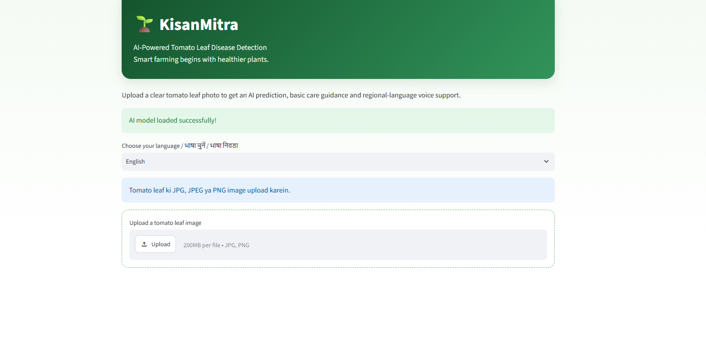
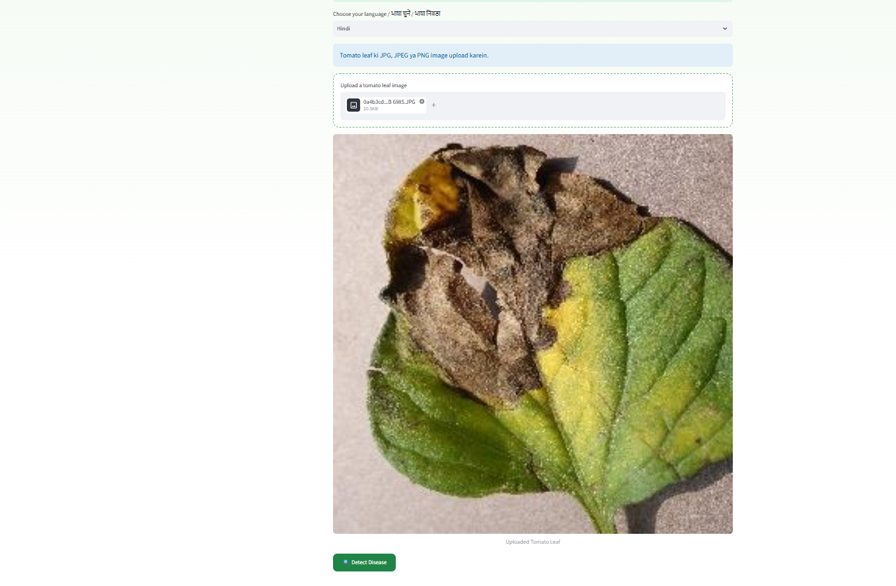
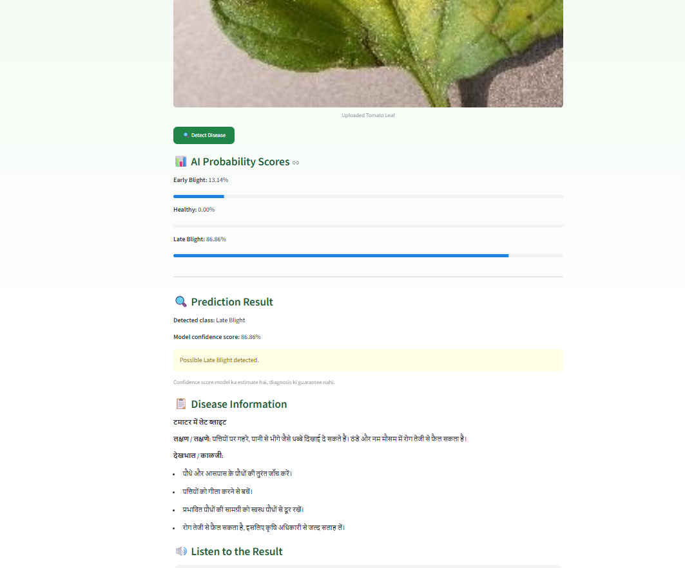

# 🌱 KisanMitra — AI Tomato Leaf Disease Detection

KisanMitra is an AI-powered educational project that identifies possible tomato leaf diseases from uploaded leaf images. It uses a trained Convolutional Neural Network (CNN) model and a Streamlit web interface to display predictions and class probabilities.

## 🎯 Project Objective

The objective of KisanMitra is to explore how AI can help farmers identify possible tomato leaf diseases and access basic guidance in familiar languages.

## ✨ Features

- Upload tomato leaf images in JPG, JPEG, or PNG format.
- Predict one of three classes:
  - Early Blight
  - Healthy
  - Late Blight
- Display predicted class and class-wise probability scores.
- Provide basic disease-related guidance.
- Support Hindi and Marathi voice output.
- Run through a Streamlit web interface.

## 🛠️ Technologies Used

- Python
- TensorFlow / Keras
- NumPy
- Pillow (PIL)
- Streamlit
- gTTS (Google Text-to-Speech)

## 📁 Project Structure

```text
KisanMitra/
├── app.py
├── requirements.txt
├── README.md
├── testing_results.md
├── DAY30_REPORT.md
└── kisanmitra_tomato_cnn_balanced_experiment.keras
```

Additional files and reports may also be present in the repository.

## ⚙️ Installation and Setup

### 1. Clone the repository

```powershell
git clone https://github.com/PrasadBuilds/KisanMitra.git
cd KisanMitra
```

### 2. Create and activate a virtual environment

**Windows PowerShell:**

```powershell
python -m venv .venv
.\.venv\Scripts\Activate.ps1
```

### 3. Install dependencies

```powershell
python -m pip install -r requirements.txt
```

### 4. Run the application

```powershell
python -m streamlit run app.py
```

Open the local URL shown in the terminal, usually `http://localhost:8501`.

## 🧪 Testing

The project has been tested with sample tomato leaf images. The recorded preliminary results are available in [`testing_results.md`](testing_results.md).

The current model can misclassify some images. Further testing and model improvement are needed.

## ⚠️ Limitations

- This is an educational prototype, not a professional agricultural diagnostic system.
- Predictions may be incorrect under real-world field conditions.
- The displayed probability is the model's output score; it does not guarantee that the prediction is correct.
- Use advice from qualified agricultural experts before making important crop-treatment decisions.
- Hindi and Marathi audio generation may require an internet connection.

## 🚀 Future Improvements

- Improve model performance using more diverse and representative images.
- Evaluate the model on a separate, carefully labelled test dataset.
- Improve disease-specific recommendations.
- Test the application on different devices and real-world leaf images.

## 👨‍💻 Developer

**Prasad Dnyaneshwar Chandgude**

Student project — AI/ML and Python.

## 📄 Disclaimer

KisanMitra is developed for educational and demonstration purposes. It should not be used as the sole basis for pesticide selection or other crop-treatment decisions.


## 📸 Application Screenshots

### 1. Home Page


### 2. Image Upload


### 3. Prediction Result


### 4. Language and Voice Output

